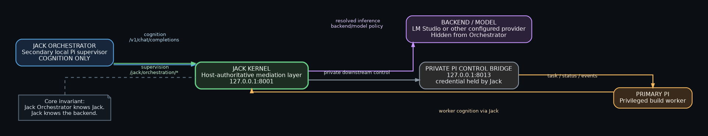
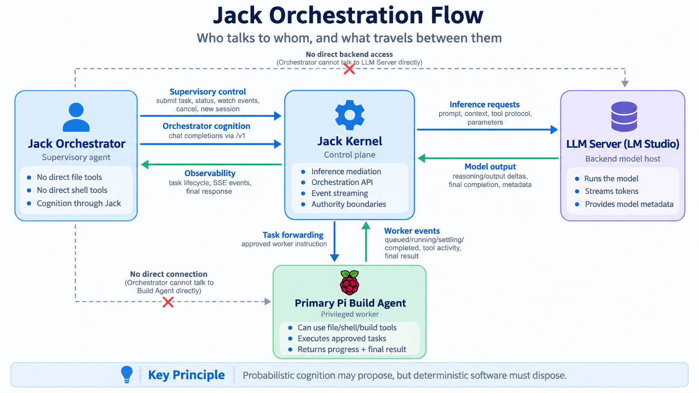

# Jack Kernel — The Harness for the Harness

**v0.1.1**

**Probabilistic cognition may propose, but deterministic software must dispose.**

Jack Kernel is a **local-first, host-authoritative inference mediation and control runtime** that sits between an application or agent and an OpenAI-compatible model backend.

Jack is **not the agent and not the LLM**. The agent chooses the task and workflow. The model supplies probabilistic cognition. Jack owns deterministic boundaries around that cognition: stage topology, reasoning and sampling controls, tool exposure, context projection, answer/commit authority, retention, evidence handling, runtime identity, consequence disposition, and selected security controls.

Deep Reasoning, Local Agentic (Preserve Thinking), and Code Debugging are **reference programs built on the kernel**. They demonstrate what Jack can express; they are not the product boundary.

> **Start here:** [`00_Jack_Kernel_Plain_English_Master_Guide_v0.1.1.docx`](00_Jack_Kernel_Plain_English_Master_Guide_v0.1.1.docx)
>
> **Install and run:** [`GETTING_STARTED.md`](GETTING_STARTED.md)
>
> **Current security state:** [`CURRENT_SECURITY_STATUS.md`](CURRENT_SECURITY_STATUS.md)
>
> **Operating Jack's security controls:** [Security Center operator guide](docs/security/SECURITY_CENTER_GUIDE.md) — select **K** in the launcher. See [StreamingIRQ sensitivity](docs/security/STREAMING_IRQ_SENSITIVITY.md) for Adaptive defaults, explicit overrides and quarantine behavior.
>
> **November 26, 2026 — Adaptive StreamingIRQ:** [PR #178](https://github.com/mlangford75-lgtm/Jack-Kernel/pull/178) merged the adaptive default. Live qualification reported 9/9 supported cognitive configurations and 3/3 security cases passing with `ling-3.0-tiny` at concurrency four. This is scoped live acceptance, not a new formal frozen-phase certification.
>
> **Security update (November 25, 2026):** Phase 9B selected executable-identity enforcement is implemented and **mandatory in the secured `--serve` child**, layered after Phase 8. It passed **98 targeted Windows Python 3.14.6 tests**, including a post-start live HTTP executable-tampering test on the real secured server ([CI evidence](https://github.com/mlangford75-lgtm/Jack-Kernel/actions/runs/45606058846)). Phase 8 remains the last formally **fully validated, frozen and tagged** security phase; Phase 9B's full regression, real external side-effect, and comprehensive release gates are not yet complete. See [current security status](CURRENT_SECURITY_STATUS.md) and [Phase 9B evidence](docs/security/README.md).

## Architecture at a glance

```text
Application / Agent / Supervisor
            |
            v
       Jack Kernel
            |
            v
OpenAI-compatible model backend
```

With Orchestration Gateway v2 enabled, Jack also mediates the supervisor-to-worker control boundary:

```text
Supervisor
   |
   v
Jack Kernel :8001/jack/orchestration
   |
   v
private authenticated worker bridge
   |
   v
Primary Pi / privileged worker
   |
   v
Jack Kernel :8001/v1
   |
   v
configured local backend
```

A cloud-model supervisor retains its native cloud cognition and uses Jack for worker control. A local-model supervisor uses Jack for both local cognition and worker control.

The accepted all-local architecture is illustrated here:





## Cognition programs and current runtime surfaces

Jack's cognition modes are **programs built on the Kernel**. They do not make Jack the agent or the model, and model-generated reasoning never becomes host authority merely because a mode produced it.

| Program | Currently documented behavior |
|---|---|
| Off | Direct inference with native thinking off |
| Medium | Direct native Medium reasoning |
| X-High | Direct native X-High reasoning |
| Deep Reasoning | Thesis → Antithesis → Synthesis |
| Local Agentic (Preserve Thinking) | Full native Stage-1 cognition and authorized tools, exact frozen A1, followed by tools-off Stage-2 working-memory distillation, host receipts, authenticated historical memory projection, memory-only downstream continuity without inherited R2, and completed-turn pruning |
| Code Debugging | Five-pass, report-only defect review using Medium reasoning |
| Code Debugging (Deep) | Same report-only topology at X-High reasoning |


For selection, supported deployment commands, and runtime lanes, see [Getting Started](GETTING_STARTED.md#3-choose-a-cognition-program).

The current integrated control surfaces include the OpenAI-compatible `/v1` API (including Responses compatibility), Orchestration Gateway v2 for supervisor-to-worker mediation, authenticated Pi worker control, and independently identified multi-endpoint runtime lanes. `runtime_id` and `lane_id` are logical identities; ports and sockets remain transport locators.

### Local Agentic (Preserve Thinking) — current runtime contract

The [`Local Agentic (Preserve Thinking)` profile](Documentation/Agentic/AGENTIC_PRESERVE_THINKING_2026-10-21.md) documents the October 2026 implementation lineage of the two-stage Agentic (Preserve Thinking) architecture. It **replaces the previous XML-based implementation** under the canonical `JACK_REASONING_LEVEL="Local Agentic (Preserve Thinking)"` selector; no parallel legacy mode is selectable. The old `agentic` selector remains accepted as a compatibility alias and resolves to the exact canonical name.

The Agentic subprofile selector accepts **Flash**, **Balanced**, **Thorough**, **Translated**, and **Coder**. Agentic Flash uses one thinking-off cognition stage followed by a deterministic host commit, with no retrospective model call; Balanced uses thinking-on cognition and a thinking-off retrospective; Thorough and Translated may use native thinking during the retrospective. Coder has separate Flash and Thorough Architect profiles. Historical Exhaustive descriptions are not the current selector contract.

Stage 1 uses the selected profile's cognition controls with authorized tools and freezes the exact user-facing answer (A1). Tools-off Stage 2 receives a source-only capsule of chronological Stage-1 reasoning and authenticated tool evidence. Canonical user request and frozen A1 ownership are verified but neither U nor A1 is replayed into the memory request. Stage 2 receives no executable tool schemas. Historical U/M/A are projected to future turns without the previous Stage-2 native R2 bridge. Stage 2 cannot revise A1. **This is the only supported Agentic Stage-2 cognitive scope**; legacy baseline, alternate isolated, differential-memory and final-paper prompt toggles no longer select other Stage-2 policies. The Nov 4 Qwen3.6/LM Studio reference configuration is documented in [the isolated reference profile](Documentation/Agentic/AGENTIC_QWEN36_ISOLATED_REFERENCE_2026-11-04.md).

Agentic tool-result continuations use host-owned checkpoints, not caller-selected stage identifiers. A dropped client stream after Jack accepts a tool result keeps that bounded, process-local checkpoint available for exact-evidence retry; conflicting tool results and concurrent duplicate resumes still fail closed. Once Stage 1 freezes its exact answer, an interrupted retrospective can resume at Stage 2 without rerunning Stage 1 or its tools. The live SSE transport emits keepalives even when streamed executable-tool fragments remain withheld pending authorization. These recovery guarantees are **process-local**: restart-safe recovery of in-flight tool payloads is not yet provided, and explicit terminal failures do not rearm checkpoints.

The tools-off retrospective runs under its **own dedicated system instruction**, distinct from the frozen-answer cognition system; external caller system instructions are excluded. The older Phase 3E cache-append layout is historical: the current buffered and streamed source-only Stage-2 paths explicitly disable it even if the old environment switch is set. Phase 3F byte accounting (`JACK_AGENTIC_CONTEXT_ACCOUNTING=1`) remains opt-in; its reporting threshold is not a token-window limit. The [three-turn Phase 3E checkpoint](Documentation/Agentic/LOCAL_AGENTIC_PHASE3E_CHECKPOINT_2026-10-22.md) is retained as historical evidence, not a current configuration recommendation. See [Current Security Status](CURRENT_SECURITY_STATUS.md) for security validation lineage.

### Coder Architect and execution authority

For the experimental November 27 changes, see the [audit reconciliation](Documentation/Independent_Audit_Remediation_Register.md#candidate-qualification-and-remaining-scope-2026-11-27). This candidate preserves exact frozen A1 when the tools-off retrospective exhausts its generation budget, without committing incomplete memory or retrying tools. Hard security interruptions remain terminal. Responses top-level `instructions` are developer-role context and are not promoted into the caller system contract under the existing policy.

Current Coder Flash and Thorough use a **tool-free Architect** to produce a visible specification for Coder. Coder is the implementation and answer-authority stage with the authorized tools; the Architect specification remains fallible working guidance, not new user authority or evidence of execution. Read-only Architect inspection belongs to a separate proposed Hybrid design, not the current Coder contract. No legacy tool-enabled Architect implementation is retired by this documentation correction.

### Local Agentic (Preserve Thinking) continuation correction

The [PR #45 historical tool-resume fix](https://github.com/mlangford75-lgtm/Jack-Kernel/pull/45) resolves a real stage-resume bug discovered while investigating Phase 9A: when a caller replays historical conversation messages, retired/nonpending tool results must not poison the current live pending transaction. The correction ignores retired results for current transaction selection **without admitting them into the resumed stage history**. Withheld-call results, duplicate live results, incomplete current results, and results spanning conflicting live transactions continue to be rejected. This correctness improvement is **not** Phase 9 Runtime Code Integrity enforcement.

## What Jack owns

Jack's host-authoritative boundary includes, where applicable:

- caller request reconstruction and hidden-authority stripping;
- virtual caller-facing model identity versus actual backend identity;
- mode and stage topology;
- stage-specific reasoning and sampling controls;
- tool visibility and tool-call validation;
- context preparation and long-horizon state projection;
- answer/commit authority;
- evidence namespace protection;
- runtime and lane identity surfaces;
- supervisor-to-worker orchestration mediation;
- deterministic security outcomes and consequence disposition;
- represented-path policy;
- the runtime-scoped Authority & Security Ledger;
- deterministic authority over the closed Phase-7 known-credential set at validated ingress/release/resource boundaries;
- bounded Phase-8 source authority over the immutable active-runtime protected component set, including suspension on measurement uncertainty and terminal invalidation on confirmed source mismatch.

Jack does not acquire authority merely because it can observe a value. Observability is not authority, evidence is not authority, a port is not identity, cancellation is not settlement, represented targets are not necessarily resolved host objects, and forensic chronology is not source authority.

## What Jack does not claim

Jack is not a universal operating-system sandbox, filesystem-object attestation layer, shell-effects oracle, distributed consensus ledger, or proof that every represented consequence was physically realized by an external executor.

Phase 8 also does not claim continuous historical attestation, loaded-code/function-binding integrity, authority-state integrity, universal filesystem-object identity, or hostile in-process tamper resistance.

See [`CURRENT_SECURITY_STATUS.md`](CURRENT_SECURITY_STATUS.md) for the exact current claims and nonclaims.

## Current security status

**Phase 8 — Active Source Authority / Source Drift Protection — is the most recent fully validated, merged, documented, tagged and frozen security phase.** Its frozen [validation tag](https://github.com/mlangford75-lgtm/Jack-Kernel/tree/security-layer-phase8-validated-2026-10-06) points to closure commit `cebe9fd75fe30a9c84a0af08d2105af448fc3d00`. Phase 8 protects selected on-disk active source identity through bounded exact measurements and authority gating; it **does not** prove integrity of loaded Python code objects or mutable authority state.

The cumulative validated security controls are:

- **Phases 0–3:** deterministic security outcomes, bounded StreamingIRQ pre-release quarantine, malformed-SSE release protection and Canary controls.
- **Phase 4:** represented-path restrictions, optional Workspace Lock, tool-release and executor admission checks.
- **Phase 5:** deterministic, proportionate consequence disposition.
- **Phase 6:** process-local Authority & Security Ledger.
- **Phase 7:** closed known-credential isolation and selected model/output/diagnostic DLP boundaries.
- **Phase 8:** immutable protected-source baseline, bounded remeasurement, source-authority suspension/invalidation and preservation of otherwise safe work.

**Phase 9A research closed without production enforcement.** The [Phase 9A research checkpoint](docs/security/SECURITY_LAYER_PHASE9A_RESEARCH_CHECKPOINT_2026-10-14.md) documents the live binding inventory, experiments, unresolved Phase 9A.4 identity differences, and the decision to defer Phase 9B. The annotated [Phase 9A research-closure tag](https://github.com/mlangford75-lgtm/Jack-Kernel/tree/security-layer-phase9a-research-closed-2026-10-14) identifies that **research milestone**, not a validated integrity guard.

Post-Phase-8 merged maintenance:

- [PR #45](https://github.com/mlangford75-lgtm/Jack-Kernel/pull/45): historical tool-result replay in the Agentic (Preserve Thinking) lineage and pending stage-resume correction.
- [PR #46](https://github.com/mlangford75-lgtm/Jack-Kernel/pull/46): Responses API exception non-disclosure while retaining sanitized Phase-7 diagnostics.
- [PR #47](https://github.com/mlangford75-lgtm/Jack-Kernel/pull/47): Phase 9A research-closure record and live status reconciliation.

The verified October 14 post-fix Windows clone at `ef613e46e70181f7fa8d054aabc3b5a744d8f704` passed **527 Python regression tests**. This is not Phase 9 security validation.

**Still unimplemented/unvalidated:** Phase 9 loaded-code/function-binding enforcement, Phase 10 authority-state integrity and Phase 11 comprehensive telemetry/privacy hardening. Jack does not claim hostile in-process tamper resistance, universal OS sandboxing, or proof of external consequences.

For authoritative current implementation claims, exclusions, and exact Phase 8 validation lineage, read [Current Security Status](CURRENT_SECURITY_STATUS.md). Preserve the dated prior-phase checkpoints in [the security archive](docs/security/README.md) as historical validation records.

## Run on Windows

The current validated development/release baseline is **Python 3.14.6**. Repository validation additionally uses **Node.js 24.16.0** for the Pi bridge harnesses.

**Pi v0.87.0 or newer required.**

From a fresh clone on Windows, prepare the isolated environment and verify Jack:

```powershell
.\setup.bat
.\run-tests.bat
.\start.bat
```

`start.bat` also runs the one-time bootstrap automatically if `.venv` is absent. All three scripts use the repository-local Python environment, including subprocess security tests; global per-user package installs are not required.

Default agent-facing endpoint:

```text
http://127.0.0.1:8001/v1
```

LM Studio is the default backend at `http://127.0.0.1:1234/v1`. Jack also supports Ollama, Jan.ai, raw llama.cpp `llama-server`, and custom OpenAI-compatible endpoints.

Port `8001` is Jack's default agent-facing listener. Port `8000` remains available for the common custom OpenAI-compatible/vLLM backend topology:

```text
agent -> Jack :8001 -> backend :8000
```
