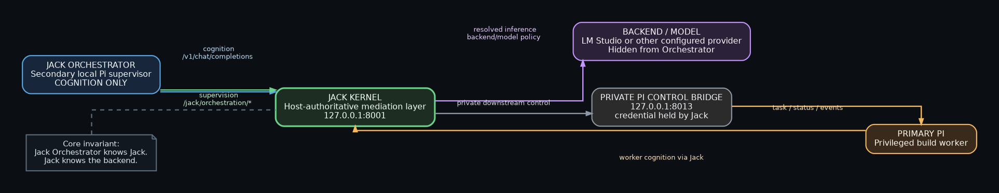
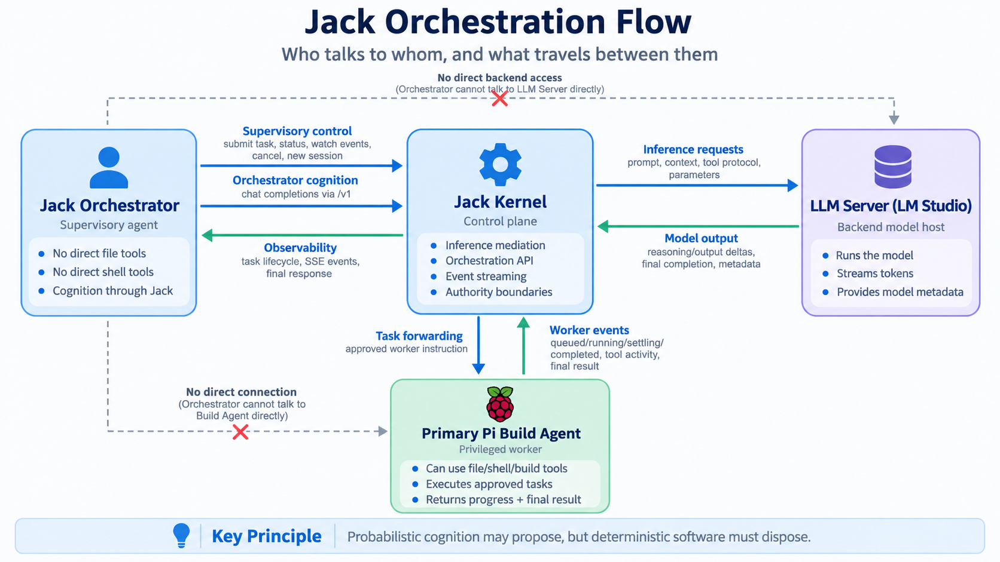

# Jack Kernel — The Harness for the Harness

**v0.1.1**

**Probabilistic cognition may propose, but deterministic software must dispose.**

Jack Kernel is a **local-first, host-authoritative inference mediation and control runtime** that sits between an application or agent and an OpenAI-compatible model backend.

Jack is **not the agent and not the LLM**. The agent chooses the task and workflow. The model supplies probabilistic cognition. Jack owns deterministic boundaries around that cognition: stage topology, reasoning and sampling controls, tool exposure, context projection, answer/commit authority, retention, evidence handling, runtime identity, consequence disposition, and selected security controls.

Deep Reasoning, Agentic (Preserve Thinking), and Code Debugging are **reference programs built on the kernel**. They demonstrate what Jack can express; they are not the product boundary.

> **Start here:** [`00_Jack_Kernel_Plain_English_Master_Guide_v0.1.1.docx`](00_Jack_Kernel_Plain_English_Master_Guide_v0.1.1.docx)
>
> **Install and run:** [`GETTING_STARTED.md`](GETTING_STARTED.md)
>
> **Current security state:** [`CURRENT_SECURITY_STATUS.md`](CURRENT_SECURITY_STATUS.md)
>
> **Latest operational checkpoint (October 14, 2026):** Phase 8 remains the last formally validated/frozen security phase. Phase 9A research closed without Phase 9 runtime-code-integrity enforcement; the Agentic (Preserve Thinking) lineage tool-resume repair (PR #45) and Responses error non-disclosure repair (PR #46) are merged, with **527 Windows Python tests passing** on the verified post-fix baseline.

## Architecture at a glance

```text
Application / Agent / Supervisor
            |
            v
       Jack Kernel
            |
            v
OpenAI-compatible model backend
```

With Orchestration Gateway v2 enabled, Jack also mediates the supervisor-to-worker control boundary:

```text
Supervisor
   |
   v
Jack Kernel :8001/jack/orchestration
   |
   v
private authenticated worker bridge
   |
   v
Primary Pi / privileged worker
   |
   v
Jack Kernel :8001/v1
   |
   v
configured local backend
```

A cloud-model supervisor retains its native cloud cognition and uses Jack for worker control. A local-model supervisor uses Jack for both local cognition and worker control.

The accepted all-local architecture is illustrated here:





## Cognition programs and current runtime surfaces

Jack's cognition modes are **programs built on the Kernel**. They do not make Jack the agent or the model, and model-generated reasoning never becomes host authority merely because a mode produced it.

| Program | Currently documented behavior |
|---|---|
| Off | Direct inference with native thinking off |
| Medium | Direct native Medium reasoning |
| X-High | Direct native X-High reasoning |
| Deep Reasoning | Thesis → Antithesis → Synthesis |
| Agentic (Preserve Thinking) | Full native Stage-1 cognition and authorized tools, exact frozen A1, followed by tools-off Stage-2 retrospective reasoning distillation, host receipts, authenticated historical memory projection, one-hop native-reasoning continuity, and completed-turn pruning |
| Code Debugging | Five-pass, report-only defect review using Medium reasoning |
| Code Debugging (Deep) | Same report-only topology at X-High reasoning |


For selection, supported deployment commands, and runtime lanes, see [Getting Started](GETTING_STARTED.md#3-choose-a-cognition-program).

The current integrated control surfaces include the OpenAI-compatible `/v1` API (including Responses compatibility), Orchestration Gateway v2 for supervisor-to-worker mediation, authenticated Pi worker control, and independently identified multi-endpoint runtime lanes. `runtime_id` and `lane_id` are logical identities; ports and sockets remain transport locators.

### Agentic (Preserve Thinking) — active cognition mode (October 2026)

The [`Agentic (Preserve Thinking)` design](Documentation/Agentic/AGENTIC_PRESERVE_THINKING_2026-10-21.md) **replaces the previous XML-based implementation** under the existing `JACK_REASONING_LEVEL=agentic` selector. There is no parallel legacy mode. The name is a user-facing label; the stable internal selector remains `agentic` for existing launchers and integrations.

Stage 1 uses native x-high cognition with authorized tools and freezes the exact user-facing answer (A1). Tools-off Stage 2 produces a retrospective semantic memory explaining how Stage 1 reached A1. Historical user turns, the host-authenticated retrospective memory, and exact frozen answers are projected separately; completed native thinking and tool protocols are retired, while the immediately previous Stage-2 native reasoning can bridge once into the next Stage 1 before retirement. Tool-result receipts are observations, not proof of filesystem effects. Stage 2 does not revise A1. The Stage-1 and Stage-2 cognition prompt text is unchanged.

On LM Studio, Agentic Stage-2 cache append (Phase 3E) is enabled by default; set `JACK_AGENTIC_STAGE2_CACHE_EXPERIMENT=0` to restore the legacy Stage-2 request layout. Non-LM Studio backends are unchanged, and forced/named tool choices use the legacy Stage-2 layout. Phase 3F byte accounting (`JACK_AGENTIC_CONTEXT_ACCOUNTING=1`) remains opt-in; its reporting threshold is not a token-window limit. The run-time behavior has been exercised with local multi-turn Pi/LM Studio experiments, but improvement against a native Pi control remains unmeasured. The last formal security checkpoint is still Phase 8.

### Agentic (Preserve Thinking) continuation correction

The [PR #45 historical tool-resume fix](https://github.com/mlangford75-lgtm/Jack-Kernel/pull/45) resolves a real stage-resume bug discovered while investigating Phase 9A: when a caller replays historical conversation messages, retired/nonpending tool results must not poison the current live pending transaction. The correction ignores retired results for current transaction selection **without admitting them into the resumed stage history**. Withheld-call results, duplicate live results, incomplete current results, and results spanning conflicting live transactions continue to be rejected. This correctness improvement is **not** Phase 9 Runtime Code Integrity enforcement.

## What Jack owns

Jack's host-authoritative boundary includes, where applicable:

- caller request reconstruction and hidden-authority stripping;
- virtual caller-facing model identity versus actual backend identity;
- mode and stage topology;
- stage-specific reasoning and sampling controls;
- tool visibility and tool-call validation;
- context preparation and long-horizon state projection;
- answer/commit authority;
- evidence namespace protection;
- runtime and lane identity surfaces;
- supervisor-to-worker orchestration mediation;
- deterministic security outcomes and consequence disposition;
- represented-path policy;
- the runtime-scoped Authority & Security Ledger;
- deterministic authority over the closed Phase-7 known-credential set at validated ingress/release/resource boundaries;
- bounded Phase-8 source authority over the immutable active-runtime protected component set, including suspension on measurement uncertainty and terminal invalidation on confirmed source mismatch.

Jack does not acquire authority merely because it can observe a value. Observability is not authority, evidence is not authority, a port is not identity, cancellation is not settlement, represented targets are not necessarily resolved host objects, and forensic chronology is not source authority.

## What Jack does not claim

Jack is not a universal operating-system sandbox, filesystem-object attestation layer, shell-effects oracle, distributed consensus ledger, or proof that every represented consequence was physically realized by an external executor.

Phase 8 also does not claim continuous historical attestation, loaded-code/function-binding integrity, authority-state integrity, universal filesystem-object identity, or hostile in-process tamper resistance.

See [`CURRENT_SECURITY_STATUS.md`](CURRENT_SECURITY_STATUS.md) for the exact current claims and nonclaims.

## Current security status

**Phase 8 — Active Source Authority / Source Drift Protection — is the most recent fully validated, merged, documented, tagged and frozen security phase.** Its frozen [validation tag](https://github.com/mlangford75-lgtm/Jack-Kernel/tree/security-layer-phase8-validated-2026-10-06) points to closure commit `cebe9fd75fe30a9c84a0af08d2105af448fc3d00`. Phase 8 protects selected on-disk active source identity through bounded exact measurements and authority gating; it **does not** prove integrity of loaded Python code objects or mutable authority state.

The cumulative validated security controls are:

- **Phases 0–3:** deterministic security outcomes, bounded StreamingIRQ pre-release quarantine, malformed-SSE release protection and Canary controls.
- **Phase 4:** represented-path restrictions, optional Workspace Lock, tool-release and executor admission checks.
- **Phase 5:** deterministic, proportionate consequence disposition.
- **Phase 6:** process-local Authority & Security Ledger.
- **Phase 7:** closed known-credential isolation and selected model/output/diagnostic DLP boundaries.
- **Phase 8:** immutable protected-source baseline, bounded remeasurement, source-authority suspension/invalidation and preservation of otherwise safe work.

**Phase 9A research closed without production enforcement.** The [Phase 9A research checkpoint](docs/security/SECURITY_LAYER_PHASE9A_RESEARCH_CHECKPOINT_2026-10-14.md) documents the live binding inventory, experiments, unresolved Phase 9A.4 identity differences, and the decision to defer Phase 9B. The annotated [Phase 9A research-closure tag](https://github.com/mlangford75-lgtm/Jack-Kernel/tree/security-layer-phase9a-research-closed-2026-10-14) identifies that **research milestone**, not a validated integrity guard.

Post-Phase-8 merged maintenance:

- [PR #45](https://github.com/mlangford75-lgtm/Jack-Kernel/pull/45): historical tool-result replay in the Agentic (Preserve Thinking) lineage and pending stage-resume correction.
- [PR #46](https://github.com/mlangford75-lgtm/Jack-Kernel/pull/46): Responses API exception non-disclosure while retaining sanitized Phase-7 diagnostics.
- [PR #47](https://github.com/mlangford75-lgtm/Jack-Kernel/pull/47): Phase 9A research-closure record and live status reconciliation.

The verified October 14 post-fix Windows clone at `ef613e46e70181f7fa8d054aabc3b5a744d8f704` passed **527 Python regression tests**. This is not Phase 9 security validation.

**Still unimplemented/unvalidated:** Phase 9 loaded-code/function-binding enforcement, Phase 10 authority-state integrity and Phase 11 comprehensive telemetry/privacy hardening. Jack does not claim hostile in-process tamper resistance, universal OS sandboxing, or proof of external consequences.

For authoritative current implementation claims, exclusions, and exact Phase 8 validation lineage, read [Current Security Status](CURRENT_SECURITY_STATUS.md). Preserve the dated prior-phase checkpoints in [the security archive](docs/security/README.md) as historical validation records.

## Run on Windows

The current validated development/release baseline is **Python 3.14.6**. Repository validation additionally uses **Node.js 24.16.0** for the Pi bridge harnesses.

Install runtime dependencies:

```powershell
py -3 -m pip install -r requirements.txt
```

Start Jack:

```powershell
.\start.bat
```

Default agent-facing endpoint:

```text
http://127.0.0.1:8001/v1
```

LM Studio is the default backend at `http://127.0.0.1:1234/v1`. Jack also supports Ollama, Jan.ai, raw llama.cpp `llama-server`, and custom OpenAI-compatible endpoints.

Port `8001` is Jack's default agent-facing listener. Port `8000` remains available for the common custom OpenAI-compatible/vLLM backend topology:

```text
agent -> Jack :8001 -> backend :8000
```
